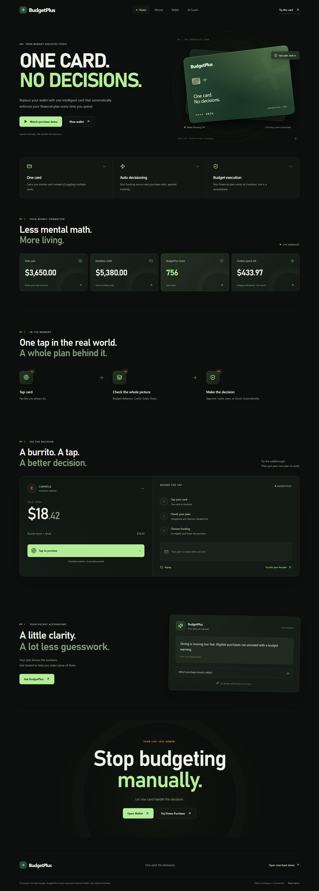
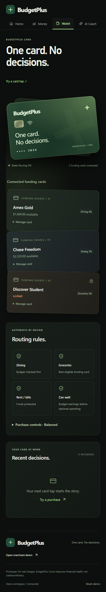
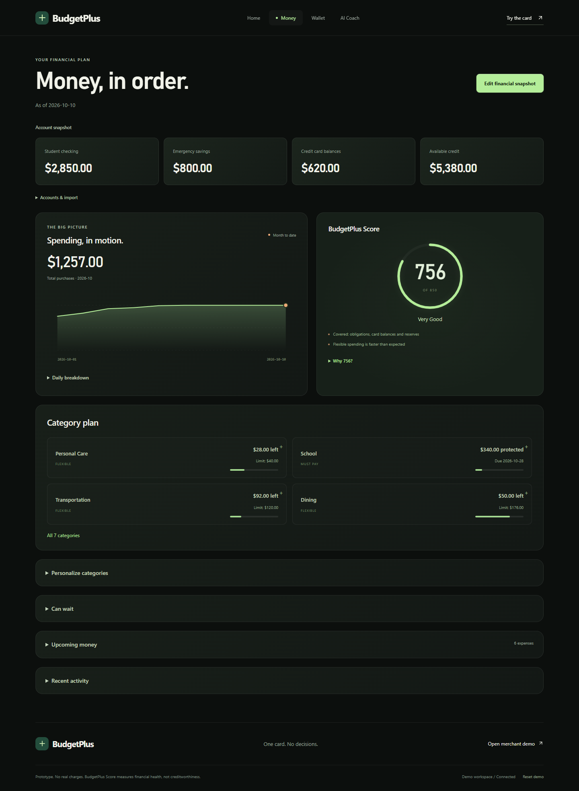
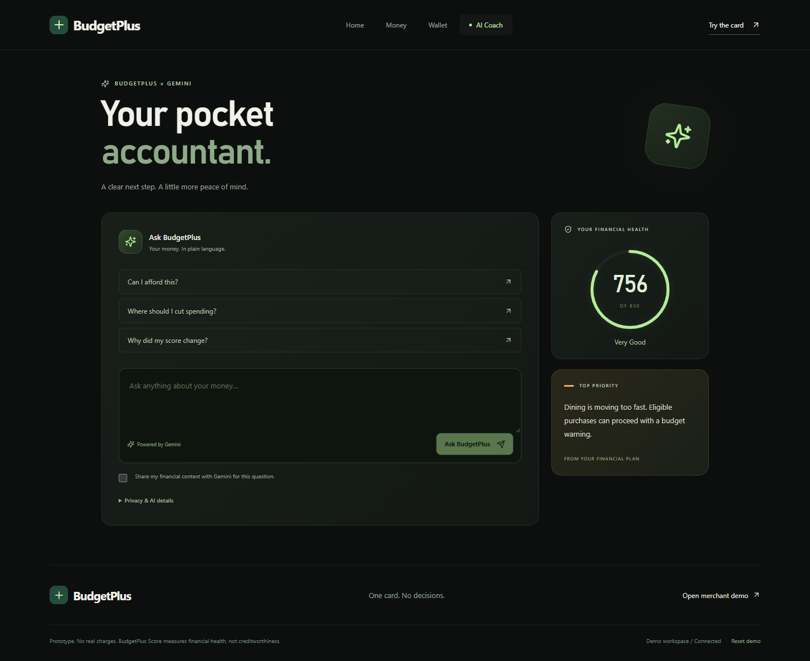
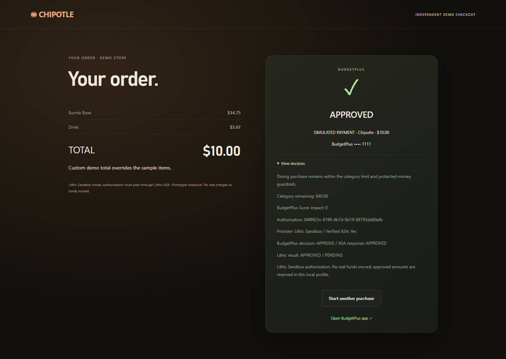
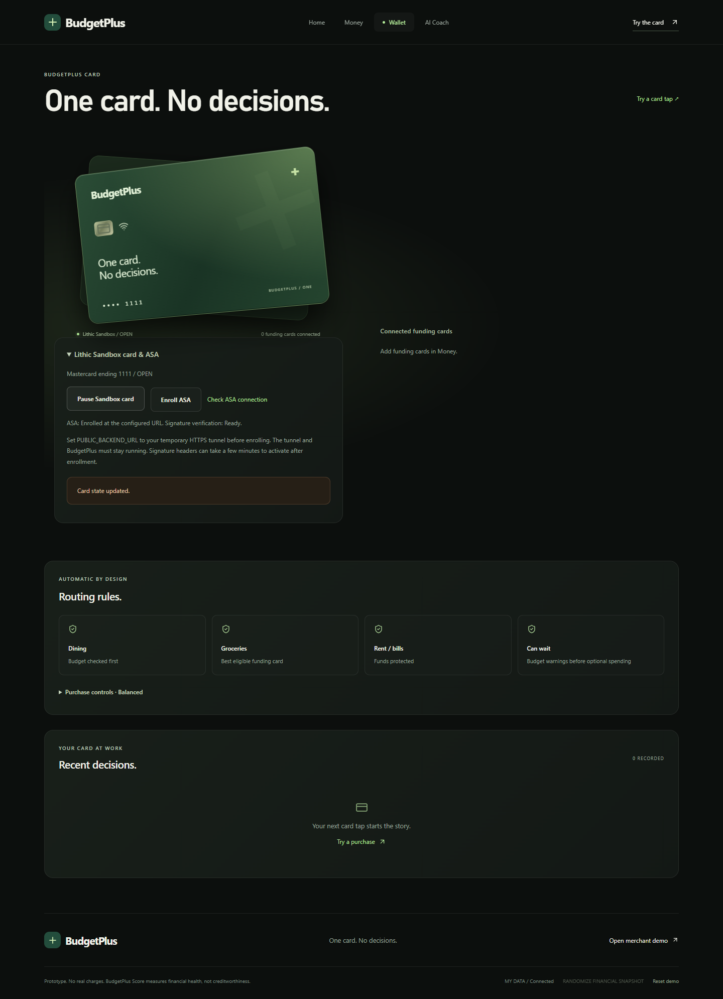

# BudgetPlus

**One card. No decisions.**

BudgetPlus is an intelligent, card-first personal finance platform and payment authorization layer. Instead of requiring users to manually budget or manage multiple credit cards at the point of sale, BudgetPlus acts as a single virtual payment card that dynamically routes authorizations to the best underlying funding source, enforces real-time spending guardrails, and protects essential reserves.

---

## 🌐 Public Demo Links

* **Live Frontend**: `https://budgetplus.vercel.app` *(Replace with your deployed Vercel URL)*
* **API Backend**: `https://budgetplus-api.onrender.com` *(Replace with your deployed Render URL)*

---

## 📸 Screenshots

| Desktop Dashboard | Mobile Wallet & Card Routing |
| :---: | :---: |
|  |  |

| Money & Category Health | AI Coach (Gemini) |
| :---: | :---: |
|  |  |

| Lithic Sandbox Card Authorization (Approved) | Merchant Simulation Terminal |
| :---: | :---: |
|  |  |

---

## 🚀 Key Features

* **Real-Time Payment Decision Engine**: Evaluates authorizations against safe-to-spend liquidity, essential obligations, protected goals, debt concentration, and category targets.
* **Lithic Sandbox Payment Authorization Layer (ASA)**: Issues virtual Sandbox Mastercards and processes live signed webhooks (`POST /api/lithic/authorize`) with HMAC-SHA256 signature verification.
* **Plaid Integration**: Connects real bank accounts, ingests up to 730 days of transaction history, and infers recurring expenses. Encrypts credentials with Fernet (AES-128-CBC).
* **AI Coach (Google Gemini)**: Analyzes financial trajectories and explains authorization decisions using `google-genai` SDK with strict privacy redaction.
* **BudgetPlus Score (300–850)**: Deterministic, non-creditworthiness scoring model assessing liquidity runway, utilization, recurring burden, and spending velocity.
* **Native Mobile Experience (Capacitor iOS)**: Packaged for mobile devices with safe-area insets, thumb bottom navigation, and full offline/sandbox fallback.

---

## 🛠 Technologies Used

* **Frontend**: React 19, Vite 6, Tailwind CSS v4, Lucide React, Capacitor 8 (iOS)
* **Backend**: Python 3.11+, FastAPI, Uvicorn, SQLite (WAL mode), Cryptography (Fernet)
* **APIs & SDKs**:
  * Lithic Python SDK (`lithic[webhooks]==0.125.0`)
  * Plaid Python SDK (`plaid-python==45.0.0`)
  * Google GenAI SDK (`google-genai>=1.0`)
  * Standard Webhooks (`standardwebhooks`)

---

## 📋 Prerequisites

* **Node.js**: `v22.12+` or `v24+`
* **Python**: `3.11+` or `3.12+`
* **Package Managers**: `npm` and `pip`

---

## 💻 Local Setup & Installation

### 1. Clone the Repository
```bash
git clone https://github.com/your-username/budgetplus.git
cd budgetplus
```

### 2. Configure Environment Variables
Copy `.env.example` to `backend/.env`:
```bash
cp .env.example backend/.env
```
*(On Windows PowerShell: `Copy-Item .env.example backend/.env`)*

Configure your API keys in `backend/.env`:
```dotenv
# Gemini (AI Coach)
GEMINI_API_KEY=your_gemini_api_key
GEMINI_MODEL=gemini-flash-latest

# Plaid (Optional for live bank data; demo mode works out-of-the-box)
PLAID_CLIENT_ID=your_plaid_client_id
PLAID_SECRET=your_plaid_secret
PLAID_ENV=sandbox

# Lithic (Optional for live card ASA; local simulation works without it)
LITHIC_API_KEY=your_lithic_sandbox_key
LITHIC_ENV=sandbox
LITHIC_CARD_PROGRAM_TOKEN=00000000-0000-0000-2000-000000000000
PUBLIC_BACKEND_URL=
```

### 3. Install Backend Dependencies & Start FastAPI
```bash
cd backend
python -m venv .venv

# Windows:
.\.venv\Scripts\Activate.ps1
pip install -r requirements.txt
uvicorn app.main:app --host 127.0.0.1 --port 8000 --reload

# macOS / Linux:
source .venv/bin/activate
pip install -r requirements.txt
uvicorn app.main:app --host 127.0.0.1 --port 8000 --reload
```
API Documentation will be live at `http://127.0.0.1:8000/docs`.

### 4. Install Frontend Dependencies & Start React
In a second terminal from the repository root:
```bash
npm install
npm run dev
```
Open `http://localhost:5173` in your browser.

*(Windows Shortcut: You can also double-click `START-BUDGETPLUS.bat` to launch both servers simultaneously).*

---

## ☁️ Deployment Guide

### Backend Deployment (Render)
1. Fork or push this repository to GitHub.
2. Sign in to [Render](https://render.com/) and click **New + > Web Service**.
3. Select your GitHub repository.
4. Fill in the service settings:
   * **Root Directory**: `backend`
   * **Runtime**: `Python 3`
   * **Build Command**: `pip install -r requirements.txt`
   * **Start Command**: `uvicorn app.main:app --host 0.0.0.0 --port $PORT`
5. Under **Environment Variables**, add:
   * `ALLOW_REMOTE_CLIENTS`: `true`
   * `LITHIC_ENV`: `sandbox`
   * `LITHIC_CARD_PROGRAM_TOKEN`: `00000000-0000-0000-2000-000000000000`
   * `GEMINI_API_KEY`: *(Your key)*
   * `LITHIC_API_KEY`: *(Your sandbox key)*
   * `PLAID_CLIENT_ID`: *(Your Plaid client ID)*
   * `PLAID_SECRET`: *(Your Plaid secret)*
   * `PUBLIC_BACKEND_URL`: *(Your Render service URL, e.g. `https://budgetplus-api.onrender.com`)*
6. Click **Create Web Service**.

### Frontend Deployment (Vercel)
1. Sign in to [Vercel](https://vercel.com/) and click **Add New > Project**.
2. Import your GitHub repository.
3. Configure the project:
   * **Framework Preset**: `Vite`
   * **Root Directory**: `./` (project root)
   * **Build Command**: `npm run build`
   * **Output Directory**: `dist`
4. Add the Environment Variable:
   * **Name**: `VITE_API_URL`
   * **Value**: `https://budgetplus-api.onrender.com` *(your deployed Render backend URL)*
5. Click **Deploy**. Vercel will build the frontend with SPA rewrites handled by `vercel.json`.

---

## 📱 Mobile App (Capacitor iOS)

```bash
# Build web app and sync into native iOS project:
npm run cap:build:ios

# Open native Xcode project (requires macOS):
npm run cap:open:ios
```

---

## 🧪 Testing

```bash
# Run backend pytest test suite (64 tests):
python -m pytest backend/tests -q

# Run frontend unit tests (15 tests):
npm test
```

---

## ⚠️ Demo & Sandbox Limitations

* **Simulated Settlement**: All monetary transfers, rewards accumulation, and card funding selections are simulated by the financial decision engine. No real bank accounts are charged.
* **Lithic Sandbox BIN**: Uses the official Lithic Sandbox Mastercard card program token (`00000000-0000-0000-2000-000000000000`). It does not move real funds.
* **Tunnel Requirement for ASA**: Receiving real-time signed webhooks from Lithic during local development requires an active HTTPS tunnel (`PUBLIC_BACKEND_URL`) such as Cloudflare Tunnel (`cloudflared`). When unconfigured, the Merchant Demo falls back to local simulation mode gracefully.
* **Privacy by Design**: Sensitive fields (full PAN, CVV, bank passwords, Plaid access tokens) are never persisted in plaintext, stored in state snapshots, or sent to Gemini or the React UI.
